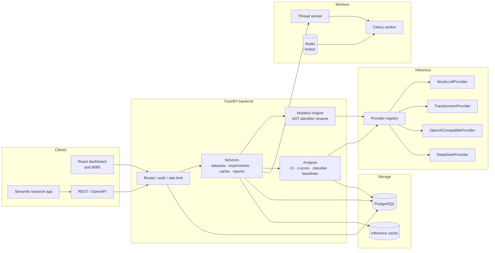
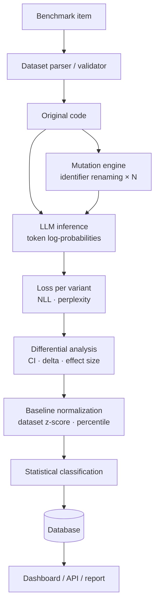

# DiffMIA — LLM Data Contamination Detection System

**Detecting LLM benchmark contamination through differential loss analysis.**

DiffMIA is a deployable research platform that probes whether an LLM has
*behaviorally memorized* benchmark code. For every benchmark snippet it measures
the model's token-level likelihood on the **original code** and on several
**semantically equivalent, identifier-renamed mutations**. If the model assigns
a meaningfully lower loss to the exact original than to its equivalent
mutations, that is evidence consistent with memorization of the original — and
a signal worth investigating.

> **Important scientific caveat.** A high differential loss is a *contamination
> signal*, not proof of contamination. It never establishes that an example
> appeared in training data. Identifier familiarity, tokenization effects,
> distributional differences, code-style familiarity and mutation artifacts can
> all produce similar behavior. Always treat results as "evidence of
> memorization-like behavior" unless independent external evidence exists.

---

## Table of contents

1. [Project overview](#1-project-overview)
2. [Architecture](#2-architecture)
3. [Installation](#3-installation)
4. [Environment variables](#4-environment-variables)
5. [Running locally](#5-running-locally)
6. [Running demo mode](#6-running-demo-mode)
7. [Running with a GPU](#7-running-with-a-gpu)
8. [Configuring Hugging Face models](#8-configuring-hugging-face-models)
9. [Configuring API models](#9-configuring-api-models)
10. [Creating datasets](#10-creating-datasets)
11. [Running experiments](#11-running-experiments)
12. [Understanding contamination scores](#12-understanding-contamination-scores)
13. [Statistical methodology](#13-statistical-methodology)
14. [API documentation](#14-api-documentation)
15. [Docker deployment](#15-docker-deployment)
16. [Testing](#16-testing)
17. [Troubleshooting](#17-troubleshooting)
18. [Research limitations](#18-research-limitations)

---

## 1. Project overview

Benchmark contamination (also called *data leakage*) happens when a model's
training corpus contains benchmark examples it is later evaluated on. Because
such examples are usually part of public GitHub dumps, instruction-tuning sets,
or web crawls, contamination can silently inflate benchmark scores.

DiffMIA operationalizes the **differential-loss hypothesis**:

> If a model memorized the exact text of an original benchmark snippet, it
> should assign significantly **lower loss** to that original than to
> semantically equivalent, never-seen mutations of it.

The system never executes uploaded code and never requires external
contamination labels: everything is derived from the model's own internal
likelihood behavior.

Key properties:

- **Provider-agnostic.** Mock (demo), Hugging Face Transformers (Llama 3,
  CodeLlama, ...), OpenAI-compatible and DeepSeek endpoints — all behind one
  interface. Providers that cannot expose input-token log-probabilities are
  cleanly reported as unsupported rather than faked.
- **Deterministic mutation engine.** AST-based identifier renaming with
  validation, reproducible seeds, and per-mutation metadata.
- **Statistical classification.** Configurable thresholds producing
  `LOW_EVIDENCE → NORMAL → ELEVATED → POSSIBLE_CONTAMINATION → HIGH_CONTAMINATION_SIGNAL`,
  with dataset-normalized baselines and z-scores.
- **Three interfaces.** A production React dashboard, a Streamlit research app,
  and a documented REST API.
- **Async by default.** Experiments run on a worker (in-process thread pool or
  Celery + Redis); HTTP requests are never blocked.
- **Reproducible & auditable.** Seeds, model/tokenizer versions, dataset
  fingerprints, configs, thresholds and timestamps are all persisted.
- **Deployable.** `docker compose up` brings up frontend, backend, PostgreSQL,
  Redis and a Celery worker. Optional NVIDIA GPU overlay included.

## 2. Architecture



Pipeline per snippet:



## 3. Installation

### 3.1 Quick start — everything in Docker (recommended)

```bash
cp .env.example .env     # optional; all values have safe defaults
docker compose up --build
```

Then open **http://localhost:8080** (React UI) or
**http://localhost:8000/docs** (OpenAPI). See
[§15 Docker deployment](#15-docker-deployment).

### 3.2 Local development (no Docker)

Requirements: **Python 3.10+** and **Node 18+**.

```bash
# Backend
python -m venv .venv
source .venv/bin/activate            # Windows: .venv\Scripts\activate
pip install -r backend/requirements-dev.txt

# Frontend
cd frontend
npm install
cd ..

# Streamlit research app (optional)
pip install -r streamlit/requirements.txt
```

## 4. Environment variables

All configuration is environment-driven; secrets are **never** hard-coded.
Copy `.env.example` to `.env` and edit. Variables of note:

| Variable | Default | Purpose |
| --- | --- | --- |
| `SECRET_KEY` | `change-me...` | Signs JWT access tokens. **Change before deploying.** |
| `ADMIN_PASSWORD` | `change-me-now` | Password of the seeded admin account. **Change before deploying.** |
| `DATABASE_URL` | `sqlite:///./data/diffmia.db` | SQLAlchemy URL. Compose uses the `POSTGRES_*` block instead. |
| `POSTGRES_USER/PASSWORD/DB` | `diffmia` | PostgreSQL credentials used by docker compose. |
| `RUN_MIGRATIONS` | `true` | Run `alembic upgrade head` at container start. |
| `REDIS_URL` | `redis://localhost:6379/0` | Broker/cache. |
| `WORKER_MODE` | `thread` | `thread` (in-process) or `celery` (dedicated worker). |
| `HF_TOKEN` | *(empty)* | Hugging Face token for gated models (Llama 3). |
| `DEEPSEEK_API_KEY` / `OPENAI_API_KEY` | *(empty)* | API provider keys. |
| `GOOGLE_CLIENT_ID` / `GOOGLE_CLIENT_SECRET` | *(empty)* | Google OAuth SSO (`/api/auth/oauth/start`). Needs a sign-in surface — see 14d. |
| `OAUTH_FRONTEND_ORIGIN` | `http://localhost:5173` | Frontend origin the OAuth callback redirects to. |
| `OAUTH_DEFAULT_ROLE` | `VIEWER` | Role granted to first-time Google sign-ins. |
| `AUTO_LOGIN_ENABLED` | `false` | This frontend has no login page: at startup it requests a session for `AUTO_LOGIN_USERNAME`. Trusted/self-hosted instances only. |
| `AUTO_LOGIN_USERNAME` | `admin` | Account that startup session belongs to (must exist, be active and verified). |
| `DEVICE` | `auto` | `auto` / `cuda` / `mps` / `cpu`. |
| `MODEL_CACHE_DIR` | `./data/models` | Local HF cache. |
| `DEMO_MODEL_ID` | `diffmia-mock` | Model used by one-click demo experiments. |
| `BUNDLED_DATASETS_DIR` | `datasets` | Folder whose dataset files are imported into the database on boot. |
| `SEED_BUNDLED_DATASETS` | `true` | Import `BUNDLED_DATASETS_DIR` at startup (idempotent; skipped by content hash). |
| `MAX_UPLOAD_MB` | `25` | Dataset upload limit. |

Model definitions live in **`configs/models.yaml`**; entries reference secrets
via `${ENV_VAR}` so no credentials are committed. The registry is seeded into
the database at startup.

## 5. Running locally

```bash
# terminal 1 — backend (SQLite fallback is automatic)
cd backend
DATABASE_URL="sqlite:///./data/dev.db" ../.venv/Scripts/python -m uvicorn app.main:app --reload --port 8000

# terminal 2 — frontend dev server (proxies /api to :8000)
cd frontend
npm run dev        # http://localhost:5173
```

On first boot the backend auto-creates tables (SQLite) and seeds the model
registry plus an admin user (`ADMIN_USERNAME`/`ADMIN_PASSWORD`).

## 6. Running demo mode

DEMO MODE uses the bundled **`diffmia-mock`** provider, which generates
deterministic synthetic loss values — **no GPU, no Hugging Face token, no paid
API**. The entire pipeline (mutations → inference → analysis → classification →
persistence → charts) runs immediately, which is ideal for validating the
product end to end.

From the React UI click **▶ Run Demo** on the landing page (or start an
experiment with the "DiffMIA Mock (Demo)" model). The UI shows a **DEMO MODE**
banner whenever the mock provider is selected. The mock intentionally embeds a
fraction of "memorized" snippets so the dashboard demonstrates both flagged and
clean results.

## 7. Running with a GPU

Local NVIDIA GPU:

```bash
docker compose -f docker-compose.yml -f docker-compose.gpu.yml up --build
```

Requires the [NVIDIA Container Toolkit](https://docs.nvidia.com/datacenter/cloud-native/container-toolkit/latest/install-guide.html).
Set `GPU_COUNT` (default `all`) and `DEVICE=cuda`. Then register/select a
transformers model (e.g. `codellama-7b`) in the UI.

Cloud GPU (e.g. a VM with an A100/H100): install the container toolkit, copy
the repo, and use the same two-file compose command. For multi-node scale-out
run one Celery worker per GPU:

```bash
# on each GPU node
docker compose -f docker-compose.yml -f docker-compose.gpu.yml \
  up -d --scale worker=N   # one worker per device
```

## 8. Configuring Hugging Face models

1. Add an entry to `configs/models.yaml`:

```yaml
models:
  my-llama:
    display_name: "My Llama"
    provider: transformers
    model_id: meta-llama/Meta-Llama-3-8B        # or codellama/CodeLlama-7b-hf ...
    device: auto                                # auto | cuda | mps | cpu
    torch_dtype: auto                           # auto | float16 | bfloat16 | float32
    description: "Local transformers model."
```

2. Provide a token for gated checkpoints in `.env`: `HF_TOKEN=hf_...`
   (available from https://huggingface.co/settings/tokens).
3. (Compose) install the heavy inference extras into the image or your venv:

```bash
pip install -r backend/requirements-transformers.txt   # torch, transformers, ...
```

4. Restart the backend — the registry row is created from YAML on startup, then
   select the model in the UI and run an experiment.

`device` is auto-detected (`cuda` → `mps` → `cpu`); set `DEVICE`/`device`
explicitly to override. Loading happens once and the provider is reused across
experiments.

## 9. Configuring API models

### OpenAI-compatible endpoints with input log-probabilities

Endpoints that echo prompt tokens with `logprobs` (vLLM, llama.cpp server,
TGI with echo) support true differential-loss scoring. `configs/models.yaml`
ships with a `vllm-local` example (`api_style: completions`, `supports_logprobs: true`):

```bash
export OPENAI_ENDPOINT=http://your-gateway:8000/v1
export OPENAI_API_KEY=...
export OPENAI_MODEL=your-served-model
```

### Chat APIs without input log-probabilities

DeepSeek / generic OpenAI chat endpoints return log-probabilities for
*generated* tokens only, which cannot score the input benchmark code. DiffMIA
handles this honestly: the provider is marked `LOGPROBS_UNSUPPORTED`, the UI
flags it, and no fabricated likelihood values are produced. (A per-item
perplexity through re-generation is not computed either — see limitations.)

## 10. Creating datasets

### Bundled datasets

The repository ships the benchmarks this tool is meant to score:

| File | Items | Dataset name | Upstream | License |
| --- | --- | --- | --- | --- |
| `datasets/humaneval.jsonl` | 164 | `humaneval` | OpenAI HumanEval | MIT © OpenAI |
| `datasets/mbpp.jsonl` | 420 | `mbpp_sanitized` | Google Research MBPP (sanitized) | CC-BY-4.0 © Google Research |
| `datasets/bigcodebench.jsonl` | 1140 | `bigcodebench` | BigCodeBench | Apache-2.0 © BigCode |
| `datasets/ds1000.jsonl` | 323 | `ds1000` | DS-1000 | CC-BY-SA-4.0 © XLang Lab (HKUNLP) |
| `datasets/sample.jsonl` | 12 | `diffmia_sample_algorithms` | first-party demo set | project license |

The upstream corpora are regenerated by `scripts/import_benchmarks.py`, which
fetches them through the Hugging Face datasets server, validates every record
with `ast.parse`, and writes the project's item schema. DS-1000 rows whose
reference code is not a top-level function definition (driver-only data-science
snippets) are skipped rather than reshaped, so the mutation engine only sees
code it can rename. See
[`datasets/README.md`](datasets/README.md) for provenance and attribution.

The repository ships benchmark files under **`datasets/`**. Every supported
file (`.json`, `.jsonl`, `.ndjson`, `.csv`, `.py`) in that folder is imported
into the database when the backend boots, so a fresh deployment lists the
project's datasets instead of an empty page. Imports are **idempotent** — a file
whose parsed content hash is already stored is skipped, so restarting never
duplicates rows, and a malformed file is logged and skipped rather than
blocking startup. The dataset name comes from the records' own `dataset_name`
field (falling back to the file name).

Drop additional `.jsonl`/`.csv`/`.py` files into `datasets/` and restart to have
them registered, or set `SEED_BUNDLED_DATASETS=false` to ingest everything by
hand instead. The one-click demo reuses the bundled sample dataset rather than
importing a second copy — both paths hash the same records.

### Uploading your own

Benchmark code is ingested as JSON / JSONL / CSV or `.py` files, or typed
manually in the UI. The internal item schema:

```json
{
  "id": "sample_001",
  "dataset_name": "my_benchmark",
  "problem_statement": "Return the sum of a list of integers.",
  "code": "def solution(numbers):\n    total = 0\n    for number in numbers:\n        total += number\n    return total",
  "language": "python",
  "metadata": {"difficulty": "easy"}
}
```

```bash
# upload via the API
curl -X POST http://localhost:8000/api/datasets/upload \
  -H "Authorization: Bearer $TOKEN" \
  -F "file=@datasets/sample.jsonl" -F "name=MyBenchmark"
```

Malformed records are rejected with structured errors; uploads are validated,
size-limited, and never executed (parsing uses `ast.parse`/`compile` in a
validation-only path — never `eval`/`exec` on benchmark input).

> Current mutation engine targets **Python**. A dataset containing other
> languages is rejected at experiment creation with a clear error, keeping the
> validation guarantees honest.

## 11. Running experiments

1. **Upload** or select a dataset.
2. **Select** a model (mock for demo; registered HF/API models for real runs).
3. **Configure**: mutations per snippet (1–20), mutation seed, strength,
   batch size, temperature, max tokens, device, optional token-loss storage.
4. **Run** — the experiment goes `QUEUED → mutation_generation → inference →
   analysis → COMPLETED` (or `FAILED`/`CANCELLED`), with live progress.
5. **Explore** the experiment detail page: the conclusion, metrics,
   distribution charts, per-snippet table, side-by-side original-vs-mutation
   diff view with rename mappings, and exports (JSON / CSV / Markdown / PDF).

Experiments are reproducible: the same seed + dataset + model config regenerates
identical mutations; inference results are cached by a content key and reused
when safe. Two properties keep the comparison honest:

- **Mutations are distinct.** Each snippet's mutations are generated with the
  variants already produced for it withheld, so a snippet with few renameable
  identifiers does not report the *same* text several times (which would
  double-count one piece of evidence). If no distinct variant can be found the
  mutation is stored as `DUPLICATE` and excluded from inference.
- **The cache write is an atomic upsert.** Scoring the same text twice — two
  snippets sharing a variant, or two workers racing — updates one cache row
  instead of aborting the experiment with a duplicate-key error.

### The conclusion

Every completed experiment carries a **conclusion** in the UI, in
`GET /experiments/{id}/results`, and at the top of every report export (JSON
key `conclusion`, Markdown/PDF *Conclusion* section). It is derived purely from
that experiment's statistics — verdict, evidence level, the flagged share, the
strongest individual signal, the shape of the loss deltas — and it always states
what it *cannot* show plus concrete next steps to corroborate or falsify the
result. The deterministic mock provider is called out explicitly as
non-evidence.

The **Reports** page is available to every signed-in role (report generation is
a read-only download), and previews the selected experiment's conclusion before
you download it.

## 12. Understanding contamination scores

For a snippet with mean-per-token loss `L_orig` on the original and
`L_mut_1 … L_mut_N` on N mutations:

```
MeanMutatedLoss = mean(L_mut_1 … L_mut_N)
CI = (MeanMutatedLoss − L_orig) / max(|L_orig|, ε)      # ε = 1e-9
```

- `CI > 0` → the original is "easier" for the model than its equivalent
  mutations — the direction consistent with memorization.
- `CI ≈ 0` → no differential behavior.
- `CI < 0` → the original is *harder*; a null/anti-signal.

Additionally each snippet gets: absolute/relative loss deltas, median & std of
mutation losses, a standardized mutation-gap effect size, dataset-normalized z-score (and global
z-score), percentile rank, and a human-readable classification reason.

Classification defaults (configurable per experiment):

| Class | Condition |
| --- | --- |
| `LOW_EVIDENCE` | snippet loss below a floor (no meaningful signal) |
| `NORMAL` | baseline range |
| `ELEVATED` | `CI ≥ 0.05` or `z ≥ 1.3` |
| `POSSIBLE_CONTAMINATION` | `CI > 0.15` **or** `z > 2.0` |
| `HIGH_CONTAMINATION_SIGNAL` | `CI > 0.35` **or** `z > 3.5` |

The UI always displays: *"Contamination scores indicate behavioral evidence
consistent with memorization. They do not establish the provenance of training
data."*

## 13. Statistical methodology

- **Loss** = mean per-token negative log-likelihood over the scored tokens of
  each code sequence (exact token accounting is documented in the code —
  prompt/completion/special-token handling per provider).
- **Baselines.** For each experiment a dataset-level baseline is computed:
  mean/median/std of the CI population. Per-snippet z-scores use a
  leave-one-out reference so a candidate cannot dilute its own anomaly score;
  the same approach is used for the optional global baseline.
- **Percentile rank** uses a tie-aware mid-rank position within its dataset
  distribution.
- **Thresholds** are configurable, never baked in, and recorded with the
  experiment.
- **Reporting honesty.** Outputs are *signals*; `HIGH_CONTAMINATION_SIGNAL`
  means the differential behavior is statistically extreme, **not** that the
  example is confirmed to be in the training set.

## 14. API documentation

Interactive OpenAPI docs: **`http://localhost:8000/docs`**. Main endpoints
(prefix `/api`):

| Method | Path | Notes |
| --- | --- | --- |
| POST | `/auth/login` | JWT + user |
| GET | `/auth/oauth/status` | `{"google_enabled": bool}` |
| GET | `/auth/google/authorize` | 302 → Google consent screen |
| GET | `/auth/google/callback` | OAuth redirect target (browser only) |
| POST | `/auth/oauth/exchange` | one-time handoff token → session token |
| GET | `/health` `/metrics` | liveness, counters |
| GET | `/demo/status` | DEMO MODE status |
| POST | `/demo/bootstrap`, `/demo/run` | one-click demo |
| GET | `/auth/oauth/status` | whether Google sign-in is configured |
| POST | `/auth/google/link/start`, `/auth/google/unlink` | attach/detach a Google identity (Settings) |
| GET | `/models`, `/models/{id}/status`, `/models/status` | registry + device |
| GET/POST | `/datasets`, `/datasets/upload`, `/datasets/{id}/items`, `/datasets/{id}/export` | datasets |
| GET | `/snippets/{id}`, `/snippets/{id}/mutations` | snippet detail |
| GET/POST | `/experiments`, `/experiments/{id}` | experiment CRUD |
| POST | `/experiments/{id}/run`, `/cancel` | lifecycle |
| GET | `/experiments/{id}/results` `/mutations` `/logs` | results |
| GET | `/experiments/{id}/export/{json,csv,markdown,pdf}` | reports |

Errors are structured: `{"error": "CODE", "message": "...", "request_id": "..."}`.
JWT auth with roles `ADMIN`, `RESEARCHER`, `VIEWER`; rate limiting and CORS are
configured server-side.

## 14b. Google sign-in (OAuth SSO)

1. In [Google Cloud Console](https://console.cloud.google.com/apis/credentials)
   create an **OAuth client ID → Web application**.
2. Add the authorized redirect URI:
   `http://localhost:8000/api/auth/google/callback`
   (production: `https://your-domain/api/auth/google/callback`).
3. Set in `.env`:

   ```bash
   GOOGLE_CLIENT_ID=...apps.googleusercontent.com
   GOOGLE_CLIENT_SECRET=...
   OAUTH_FRONTEND_ORIGIN=http://localhost:5173   # frontend origin, no trailing slash
   OAUTH_DEFAULT_ROLE=VIEWER                     # role for first-time sign-ins
   ```

4. Restart the backend. The login page now shows **Continue with Google**.

How it works: the backend mints a signed, single-use, IP-bound `state`, sends
the browser to Google, validates the returned ID token against Google's JWKS
(signature, issuer, audience, expiry, `email_verified`), provisions the
account (linking an existing local account with the same email), and hands the
browser a **one-time, 2-minute token in the URL fragment**. The frontend
exchanges it at `/api/auth/oauth/exchange` for a normal session — the handoff
token cannot be reused and fragments are never sent to servers. Users keep
their password login; Google accounts get the role from `OAUTH_DEFAULT_ROLE`.

### Diagnosing a failed sign-in

A failed callback redirects to `/login` (or `/settings` for a link flow) with
`?oauth_error=<CODE>&message=<reason>`, and the page renders `<reason>`. The
message is only taken from the query string for codes listed below, and only up
to 400 characters, so query text cannot be injected into the UI.

| Code | Meaning |
| --- | --- |
| `OAUTH_NOT_CONFIGURED` | `GOOGLE_CLIENT_ID` / `GOOGLE_CLIENT_SECRET` are not both set |
| `OAUTH_STATE_INVALID` | the signed `state` expired, was already used, or came from another browser session |
| `OAUTH_TOKEN_EXCHANGE` | Google refused the token exchange — the message carries Google's own error code |
| `OAUTH_ACCOUNT_DISABLED` | the matching local account is disabled |
| `OAUTH_GOOGLE_ERROR` / `OAUTH_CANCELLED` | Google reported an error, or the user declined |
| `OAUTH_FAILED` / `OAUTH_INVALID_RESPONSE` | unexpected failure, or a malformed callback |

`OAUTH_TOKEN_EXCHANGE` is the one worth reading: it surfaces Google's raw error
code, which distinguishes the three failures that otherwise look identical —
`invalid_client` (wrong/mistyped client secret), `redirect_uri_mismatch` (the URI
is not registered for that client), and `invalid_grant` (the code expired, was
already used, or belongs to another client). The same reason is written to the
backend log at WARNING, so an operator does not need to reproduce the flow.
`scripts/check_google_oauth.py` validates a client ID/secret pair against Google
directly, without a browser round trip. If that script says the pair is valid and
Google still refuses, the problem is on Google's side and no code change can fix
it — the two failure pages worth recognising are:

- **`Error 400: redirect_uri_mismatch`** — the URI is not registered for that
  client. It must sit under **Authorized redirect URIs** (not "Authorized
  JavaScript origins"), matching exactly, with no trailing slash.
- **`500. That's an error.`** — Google's generic page, meaning the request never
  reached this server. Usually the OAuth consent screen is unpublished
  ("Testing") or the account signing in is not a Test user. Add the account under
  **Test users**, or publish the app (the scopes here — `openid email profile` —
  are non-sensitive, so publishing needs no verification). A trailing space in a
  registered redirect URI can also cause this.

### Linking Google to an existing account

**Settings → Connected accounts** lets a signed-in user attach (or detach) a
Google identity. `POST /api/auth/google/link/start` binds the account into the
same signed state (`intent=link`, `uid=<account>`), so the browser can be sent
to Google without a session token in the URL; the callback then attaches the
identity, refusing to steal one that belongs to another account
(`GOOGLE_ALREADY_LINKED`) and marking the address verified only when Google
vouches for the same email. Linking never removes password login, and
`POST /api/auth/google/unlink` refuses to unlink an account that has no
password — otherwise the user would be locked out. The raw Google subject is
never returned by the API; clients see a boolean `google_linked`.

## 14c. Self-service registration (sign-up)

Off by default. To let visitors create their own accounts, set in `.env`:

```bash
REGISTRATION_ENABLED=true
REGISTRATION_DEFAULT_ROLE=VIEWER   # never ADMIN — enforced server-side
```

The sign-up form lives on the login page, which this build does not ship (see 14d).
Registration requires a username (3–64 chars, `[A-Za-z0-9_.-]`), an email
(unique, case-insensitive) and a password of at least 8 characters; new users
are signed in immediately. The endpoint shares the login rate limiter and
returns `409` for duplicate username/email, `422` for validation failures and
`403` when the flag is off. Admins manage accounts on the **Users** page (promote roles, enable/disable,
see each account's auth provider and verification state).

### Email verification

Self-registered accounts must confirm their address before they can sign in
(`EMAIL_VERIFICATION_REQUIRED=true`, the default). The verification link is a
signed, single-use, 24-hour token; the login page offers an inline resend for
accounts that never received it. Google-provisioned and admin-seeded accounts
are pre-verified. With no SMTP configured the emails are logged and, outside
production, the link is returned in the API response so flows can be tested
without a mail server.

### Password reset

"Forgot your password?" on the login page sends a signed, single-use,
one-hour reset link. The endpoint always answers identically whether or not
the account exists, so it leaks no account information.

## 14d. Running without a login page

This build ships **without a login page**: instead of presenting a sign-in
screen, the frontend asks the backend for a session as it starts and renders the
dashboard directly. To run that way, set in `.env`:

```bash
AUTO_LOGIN_ENABLED=true
AUTO_LOGIN_USERNAME=admin     # must exist, be active and have a verified email
```

`POST /api/auth/auto-login` then issues a normal JWT for that account, so every
page, role check and audit entry behaves exactly as it does for a password
login. It refuses to do so unless the flag is on (`403`), and unless the account
exists, is active and verified (`401`, with the reason); the call shares the
login rate limiter.

**Security:** with the flag on, anyone who can reach the API obtains a session
for `AUTO_LOGIN_USERNAME` — no password, no Google consent. Use it for local or
otherwise trusted deployments only; leave it `false` for anything public.

What still works without the page: password-reset and email-verification links
(their routes are unchanged), the admin **Users** page, and Google account
linking from **Settings**. The registration, forgot-password, reset and verify
routes remain served, but nothing in the UI links to them any more. If a session
cannot be established, the app shows the server's reason with a retry button
instead of falling back to a sign-in form.

## 15. Docker deployment

```bash
docker compose up --build            # full stack
docker compose -f docker-compose.yml -f docker-compose.gpu.yml up --build   # + NVIDIA GPU
```

Services: `frontend` (nginx → React SPA, default port **8080**), `backend`
(FastAPI, port 8000, runs Alembic migrations and seeds on start), `worker`
(Celery, consumes experiment jobs), `postgres` (primary storage) and `redis`
(broker). Host ports: `FRONTEND_PORT=8080`, `BACKEND_PORT=8000`.

Verification:

```bash
curl http://localhost:8000/api/health          # {"status":"ok", ...}
curl http://localhost:8080                     # SPA
```

Deployment flavors:

- **Local CPU:** the default compose stack works out of the box.
- **Local/cloud NVIDIA GPU:** add the GPU overlay (above), select a
  transformers model, set `DEVICE=cuda`.
- **API-only inference:** no GPU needed — register an API-backed model and keep
  `DEVICE` unused; heavy `torch` deps are not required for API/mock providers.

Production notes: change `SECRET_KEY` and `ADMIN_PASSWORD`; put the stack behind
TLS (reverse proxy); back up the `postgres_data` volume; prefer `WORKER_MODE=celery`
for anything beyond a single node. Schema upgrades use Alembic —
`alembic upgrade head` runs automatically at container start
(`RUN_MIGRATIONS=true`).

## 16. Testing

```bash
cd backend
../.venv/Scripts/python -m pytest -q          # 61 unit + integration tests
```

Coverage areas: AST mutation + identifier extraction, validation & determinism,
loss/CI/z-score/effect-size math, classifier thresholds, dataset ingestion,
cache keys, the mock provider, the full analysis pipeline, REST API auth/flows
and an end-to-end demo experiment (mock model, SQLite). The mock provider means
the suite needs **no model downloads, GPU or network keys**.

Frontend typechecks with `npm run build` (tsc + vite). The Streamlit app can be
smoke-run against a live backend:

```bash
streamlit run streamlit/app.py
```

## 17. Troubleshooting

| Symptom | Fix |
| --- | --- |
| `Invalid username or password` | Use the seeded `ADMIN_USERNAME`/`ADMIN_PASSWORD`; admins manage users under Settings. |
| Model load fails | Confirm the model id, `HF_TOKEN` for gated repos, device free memory; check structured logs (`LOG_LEVEL=DEBUG`). |
| `LOGPROBS_UNSUPPORTED` | Chat APIs do not expose input-token logprobs — use a vLLM/llama.cpp echo endpoint (`supports_logprobs: true`) or a transformers model. |
| Dataset rejected as non-Python | The identifier-rename mutation currently supports Python only. |
| Experiments stall as `QUEUED` | With `WORKER_MODE=celery` ensure Redis and the worker service are up (`docker compose ps`). |
| `database is locked` (local SQLite) | Multiple processes writing one SQLite file; use one backend process or PostgreSQL. |
| Port already in use | Override `FRONTEND_PORT` / `BACKEND_PORT` in `.env`. |
| PDF export error | `reportlab` missing → `pip install -r backend/requirements.txt`. |

## 18. Research limitations

DiffMIA measures **behavioral evidence consistent with memorization**. It does
not and cannot prove that a benchmark example appeared in a model's training
corpus. Differential loss can also reflect:

- identifier/format familiarity from similar (not identical) code seen in
  training;
- tokenization effects — a renamed variable can change token boundaries;
- distributional differences and model priors about naming conventions;
- mutation artifacts or imperfect semantic equivalence;
- prompt/style effects independent of content memorization.

Additional honest caveats:

- Providers that cannot expose input-token log-probabilities are reported as
  unsupported; DiffMIA never fabricates likelihood values.
- Classifications are threshold-based suggestions designed for triage, not
  court evidence. Flags should be followed by manual inspection and, where
  possible, external verification.
- The identifier-rename strategy targets Python code; other languages need
  additional validators.
- Small snippet counts weaken z-score/percentile estimates (minimum baseline
  size is enforced and reported).

Use DiffMIA to **prioritize** suspicious benchmark items for closer inspection —
never as a standalone accusation.

---

## License

MIT — see [LICENSE](LICENSE).
